  

  

  
  
  

---

## About me

Software and AI engineer delivering end-to-end solutions, from analysis and architecture to deployment and
measurement: websites that rank on Google and appear in AI answers, workflow automations, AI agent systems
and the infrastructure they run on. Freelance since 2025.

Every project follows the same six steps: **think it through → structure → plan → build → check the data → improve.**

- 🎓 Associate degree, Brigham Young University–Idaho (2026) · B.S. Software Development in progress
- 🌐 Spanish (native) · English (fluent) · Papiamento

## Live from my server

  
  

  

These cards redraw themselves every 6 hours from my server's public status, through a GitHub Action in this repository.

## What I do

| | |
|---|---|
| 🌐 **Websites that get found** | Hand-built, fast websites for businesses, made for Google and for the AI assistants people now ask instead. Structured data, clear facts, Core Web Vitals. |
| 🔎 **Seen in AI answers** | I measure what AI assistants with web search say about a business, then fix what makes them leave it out, and check the result again. |
| ⚙️ **Automations** | Work that repeats becomes a scheduled job, with checks before anything ships, spend caps where money is involved and a human yes where it matters. |
| 🤖 **AI agents** | Teams of agents with one job each, the tools for that job and a budget, and a critic that checks the result and can send it back. |
| ☁️ **Infrastructure** | The servers behind it all, built and run myself: Docker, monitoring and alerts, encrypted nightly backups, no open ports. |
| 📊 **Data** | Search Console, analytics and logs decide what to improve next, not opinions. |

## Some of what I've built

- **BEACON**, an AI-visibility and SEO engine for my client sites
- **A video pipeline** that writes, animates, checks and posts short videos by itself (the numbers are in the card above)
- **[My own cloud](https://github.com/stevensitosava/homelab)**, a 2020 laptop that runs 19 containers around the clock
- **OCTOPUS**, **AdFlow** and **[AI Agency](https://github.com/stevensitosava/ai-agency)**, systems of AI agents
- **[Archivos Oscuros](https://www.archivososcuros.com)**, **Try a Haircut** and **Clip Studio**, products of my own

## Tech stack

  
  
  
  
  
  
  
  
  
  
  
  
  
  
  
  
  
  
  
  
  
  

## GitHub stats

  
  

  

  

  

